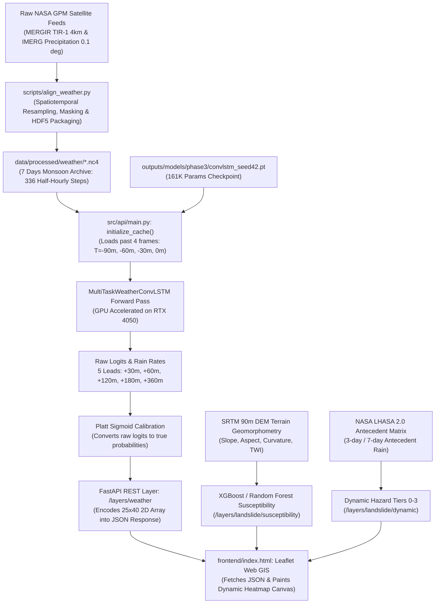

# Beginner Code Walkthrough & Architectural Map

**Project Title:** Multimodal AI Platform for Convective Nowcasting and Landslide Risk Prediction  
**Academic Program:** B.Tech Honours Major Project (2026–27), Royal Global University  
**Target Audience:** Undergraduate Student & Examining Committee  
**File Path:** `outputs/reports/local_run_and_code_guide/BEGINNER_CODE_WALKTHROUGH.md`  

---

## 1. High-Level Architectural Journey

Before examining individual lines of code, understand how data moves through the entire platform. The diagram below illustrates the exact end-to-end data pipeline:



---

## 2. Answers to the 12 Architectural Questions

### Q1: What does each major folder in the repository do?
- **`src/`**: The core source code repository. Contains:
  - `src/api/`: The production FastAPI web server (`main.py`) which exposes REST endpoints and serves the frontend.
  - `src/models/`: PyTorch neural network definitions (`convlstm.py`, `baselines.py`, `experimental/simvp.py`).
  - `src/evaluation/`: Metric computation scripts (CSI, FSS, Brier score, ROC-AUC).
- **`data/`**: Geospatial and satellite datasets.
  - `data/raw/`: Raw GeoJSON boundary files (`meghalaya_boundary.geojson`) and satellite granules.
  - `data/processed/`: Aligned netCDF-4 (`.nc4`) grids for weather (`weather/`), 90m SRTM terrain features (`terrain/`), and antecedent landslide hazard (`landslide/`).
- **`outputs/`**: Experiment tracking and persistence directory.
  - `outputs/models/`: Saved neural checkpoints (`convlstm_seed42.pt`, `mlp_seed42.pt`, etc.) and scikit-learn models (`xgboost_spatial_cv.joblib`).
  - `outputs/reports/`: Research logs, verification CSVs, and audit reports.
- **`frontend/`**: The client-side Leaflet Web GIS single-page application (`index.html`).
- **`scripts/`**: Offline data preparation, training, calibration, and validation scripts (`align_weather.py`, `train_weather_convlstm.py`, `test_live_application.py`).

---

### Q2: Which file starts the backend?
**`src/api/main.py`**  
Started using Uvicorn ASGI server:
```powershell
.venv\Scripts\python.exe -m uvicorn src.api.main:app --host 127.0.0.1 --port 8000
```
When this file runs, it starts the event loop, registers all REST endpoints, initializes the global `DataCache`, and loads the PyTorch models onto the GPU.

---

### Q3: Which file starts the frontend?
**`src/api/main.py`** (line 1004–1005):
```python
if FRONTEND_DIR.exists():
    app.mount("/", StaticFiles(directory=str(FRONTEND_DIR), html=True), name="frontend")
```
There is **no separate Node.js server**. FastAPI mounts the `frontend/` directory directly at the root URL `/`. When you navigate to `http://127.0.0.1:8000/`, FastAPI automatically serves `frontend/index.html`.

---

### Q4: How does the frontend communicate with the backend?
Through standard asynchronous JavaScript `fetch()` calls.  
Inside `frontend/index.html`, helper functions (such as `loadWeatherLayer()` and `inspectCell()`) make HTTP requests to the backend:
```javascript
// Example from frontend/index.html:
const url = `/layers/weather?step=${currentStep}&model=${currentModel}&lead=${currentLead}&calibrated=${isCalibrated}`;
const response = await fetch(url);
const data = await response.json();
```
The backend returns structured JSON containing numerical 2D grids, which the frontend renders directly onto a Leaflet canvas.

---

### Q5: Where is the ConvLSTM architecture defined?
**`src/models/convlstm.py`**  
The model is implemented in three key classes:
1. `ConvLSTMCell(nn.Module)` (lines 24–102): The recurrent cell where matrix multiplications are replaced with 2D convolutions.
2. `MultiTaskWeatherConvLSTM(nn.Module)` (lines 105–230): The multi-task network with an encoder, recurrent hidden state propagation, and dual output heads (binary classification + continuous precipitation regression).
3. `RuntimeWeatherConvLSTM(nn.Module)` (lines 233–315): Lightweight wrapper that loads weights and runs single-batch inference.

---

### Q6: Where is the actual ConvLSTM checkpoint loaded?
**`src/api/main.py`** in `initialize_cache()` (lines 257–272):
```python
ckpt_convlstm = OUTPUTS_DIR / "models" / "phase3" / "convlstm_seed42.pt"
if ckpt_convlstm.exists():
    m_convlstm = MultiTaskWeatherConvLSTM(num_leads=5)
    m_convlstm.load_state_dict(
        torch.load(ckpt_convlstm, map_location=cache.device, weights_only=False)
    )
    m_convlstm.to(cache.device)
    m_convlstm.eval()
    cache.canonical_convlstm_model = m_convlstm
```
The checkpoint is loaded onto `cuda:0` during server startup and kept in memory to allow sub-15ms inference.

---

### Q7: How is weather data prepared before inference?
In **`src/api/main.py`** inside the route handler `get_weather_layer()` (lines 430–485):
1. **Temporal Slicing:** The user selects a time step $t$ (e.g., step 316). The code extracts the 4 most recent half-hourly frames ($t-3, t-2, t-1, t$).
2. **Channel Stacking:** For each frame, three 2D grids ($25 \times 40$) are stacked:
   - Channel 0: Thermal Infrared Brightness Temperature (Kelvin, normalized: $\frac{T_{\text{IR}} - 200}{100}$).
   - Channel 1: IMERG Precipitation Rate ($\text{mm/hr}$, log-transformed: $\log_{1p}(R)$).
   - Channel 2: Satellite Observation Mask ($1.0 = \text{valid observation}, 0.0 = \text{missing}$).
3. **Tensor Creation:** The 4 frames are formatted into a PyTorch tensor of shape:
   $$\mathbf{X} \in \mathbb{R}^{B \times T_{\text{in}} \times C \times H \times W} = [1, 4, 3, 25, 40]$$
4. **Device Transfer:** Transferred to GPU memory (`.to(cache.device)`).

---

### Q8: How is a rainfall forecast generated?
In **`src/api/main.py`** (lines 490–550):
1. **PyTorch Forward Pass:**
   ```python
   with torch.no_grad():
       logits, rain_rates = cache.canonical_convlstm_model(x_tensor)
   ```
   - `logits`: Shape `[1, 5, 25, 40]` representing convective event logits ($\ge 5\text{ mm/hr}$) for 5 lead times.
   - `rain_rates`: Shape `[1, 5, 25, 40]` representing estimated rain rate ($\text{mm/hr}$).
2. **Platt Scaling Calibration:**  
   Raw logits are uncalibrated because training used a weighted BCE loss ($\text{pos\_weight} \approx 20$). The server applies Platt sigmoid scaling:
   $$P_{\text{calibrated}} = \frac{1}{1 + \exp(-(a \cdot \text{logit} + b))}$$
   where $a$ and $b$ are empirical parameters fitted on validation data.
3. **Array Extraction:** The 2D slice for the selected lead time is extracted into a NumPy array and converted into a list of floating-point values for JSON serialization.

---

### Q9: How do forecast results reach the map?
1. FastAPI returns a JSON payload:
   ```json
   {
     "lead_time": "30m",
     "calibrated": true,
     "grid": {
       "latitudes": [24.5, 24.6, ..., 27.0],
       "longitudes": [89.5, 89.6, ..., 93.5],
       "values": [[0.02, 0.15, ...], ...]
     }
   }
   ```
2. In `frontend/index.html`, the Leaflet map receives the 2D array.
3. For each cell $(i, j)$, the script computes the bounding box coordinates $[\text{lat}_i, \text{lon}_j]$ to $[\text{lat}_{i+1}, \text{lon}_{j+1}]$.
4. A color lookup function maps probability ($0.0 \to 1.0$) or rain rate ($0 \to 50\text{ mm/hr}$) to an RGBA color gradient (light blue $\to$ dark blue $\to$ yellow $\to$ red).
5. The colored rectangles are rendered onto Leaflet's HTML5 Canvas layer.

---

### Q10: How are landslide susceptibility and dynamic hazard tiers calculated?
Implemented in **`src/api/main.py`**:
1. **Static Susceptibility (`/layers/landslide/susceptibility`, lines 610–650):**
   - Derived from 90m SRTM DEM geomorphometric features: slope, aspect, profile curvature, planform curvature, and Topographic Wetness Index (TWI).
   - Pre-computed using XGBoost and Random Forest models trained on 38 verified Geological Survey of India (GSI) historical landslide occurrences.
   - Values range from $0.0$ (flat lowlands) to $1.0$ (steep southern Khasi & Jaintia escarpments).
2. **Dynamic Hazard Tiers (`/layers/landslide/dynamic`, lines 655–710):**
   - Inspired by NASA's Landslide Hazard Assessment for Situation Awareness (LHASA 2.0).
   - Computes an Antecedent Rainfall Index (ARI) over 3-day and 7-day windows:
     $$\text{ARI} = \sum_{d=1}^{7} w_d \cdot P_d$$
   - Combines ARI with static susceptibility via a 2D decision matrix into 4 discrete hazard tiers:
     - **Tier 0:** None (Green)
     - **Tier 1:** Low (Yellow)
     - **Tier 2:** Moderate (Orange)
     - **Tier 3:** High (Red)

---

### Q11: How do the Explainable-AI (XAI) methods work?
Implemented in **`src/api/main.py`** at endpoint `/explain/weather` (lines 880–960):
- **Integrated Gradients (Sundararajan et al., ICML 2017):**
  1. Creates an all-zero baseline tensor $\mathbf{X}_{\text{baseline}}$ (representing zero rainfall and clear sky).
  2. Generates $m=10$ linear interpolation steps between $\mathbf{X}_{\text{baseline}}$ and the actual input $\mathbf{X}$:
     $$\mathbf{X}_\alpha = \mathbf{X}_{\text{baseline}} + \frac{k}{m} (\mathbf{X} - \mathbf{X}_{\text{baseline}})$$
  3. Computes the gradient of the predicted rain rate at the target storm center with respect to each input channel using PyTorch autograd:
     $$\mathbf{G}_k = \nabla_{\mathbf{X}_\alpha} f(\mathbf{X}_\alpha)$$
  4. Approximates the path integral:
     $$\text{Attribution} = (\mathbf{X} - \mathbf{X}_{\text{baseline}}) \odot \frac{1}{m} \sum_{k=1}^{m} \mathbf{G}_k$$
- The resulting heatmap highlights which past satellite frames and geographic sectors contributed most strongly to the forecast.

---

### Q12: Where are errors logged and how to troubleshoot them?
1. **Console & ASGI Logs:**  
   Uvicorn prints all incoming HTTP requests, response latency, and traceback errors directly to the terminal where the server was launched.
2. **HTTP Error Codes:**
   - `404 Not Found`: Triggered if a time step outside the July 1–7, 2025 pilot range (steps 0–335) is requested.
   - `422 Unprocessable Entity`: Triggered if coordinates outside Meghalaya ($24.5^\circ - 27.0^\circ\text{N}$, $89.5^\circ - 93.5^\circ\text{E}$) are submitted to `/cell_inspect`.
   - `500 Internal Server Error`: Indicates an unhandled Python exception (e.g., GPU Out-Of-Memory or missing file).

---

## 3. Detailed File Catalog

### 1. `src/api/main.py`
- **Role:** Production ASGI server entry point.
- **Key Functions:**
  - `initialize_cache()`: Loads datasets, GeoJSON boundaries, and model checkpoints into RAM and GPU VRAM.
  - `get_weather_layer()`: Runs PyTorch ConvLSTM / baseline inference for a specified timestamp and lead time.
  - `get_susceptibility_layer()`: Serves 90m SRTM static susceptibility grid.
  - `get_dynamic_hazard_layer()`: Computes LHASA 2.0 dynamic hazard matrix.
  - `inspect_cell()`: Returns dual-stack meteorology and geomorphology for clicked coordinates.
  - `explain_weather()`: Computes Integrated Gradients attribution maps.
- **Inputs:** HTTP query parameters (`step`, `lead`, `model`, `lat`, `lon`, `calibrated`).
- **Outputs:** JSON responses and HTML/JS frontend assets.
- **Callers:** Browser frontend (`frontend/index.html`) and test suites.

### 2. `src/models/convlstm.py`
- **Role:** Canonical PyTorch neural network definitions.
- **Key Classes:**
  - `ConvLSTMCell`: Computes convolutional input, forget, cell, and output gates.
  - `MultiTaskWeatherConvLSTM`: Encodes 4 spatiotemporal frames and decodes 5 forecast leads with classification and regression heads.
- **Inputs:** Tensor $[B, 4, 3, 25, 40]$ (Batch, Time, Channels, Height, Width).
- **Outputs:** Tuple `(logits, rain_rates)` each of shape $[B, 5, 25, 40]$.
- **Callers:** `src/api/main.py`, `scripts/train_weather_convlstm.py`.

### 3. `frontend/index.html`
- **Role:** Interactive Web GIS interface.
- **Key Components:**
  - Leaflet Map (`L.map('map')`) initialized to Meghalaya coordinates $[25.5, 91.5]$.
  - Playback Controls: Play/pause, step slider (0 to 335), and date/time display.
  - Model & Lead Selectors: Dropdowns for ConvLSTM, Optical Flow, Persistence, and leads (+30m to +360m).
  - Dual Layer Overlays: Rainfall heatmap, 90m Landslide Susceptibility, LHASA 2.0 Dynamic Hazard, and Historical Event pins.
  - Cell Inspector Sidebar: Displays instantaneous rain rate, 6-hour forecast curve, slope gradient, and hazard tier.
- **Inputs:** User clicks and mouse drags.
- **Outputs:** Dynamic DOM updates and Leaflet canvas rendering.
- **Callers:** User web browser (`http://127.0.0.1:8000/`).

### 4. `data/processed/weather/aligned_weather_mergir_YYYYMMDD.nc4`
- **Role:** Aligned NetCDF-4 weather data archives.
- **Contents:**
  - `input_precip`: IMERG calibrated surface precipitation rate ($\text{mm/hr}$).
  - `satellite_tir1_mean`: NASA MERGIR $4\text{ km}$ Thermal Infrared Brightness Temperature (Kelvin).
  - `satellite_mask`: Quality observation flag ($1 = \text{valid}, 0 = \text{missing}$).
  - `reference_time_iso`: ISO 8601 UTC timestamps.
- **Callers:** `src/api/main.py`, training scripts.
