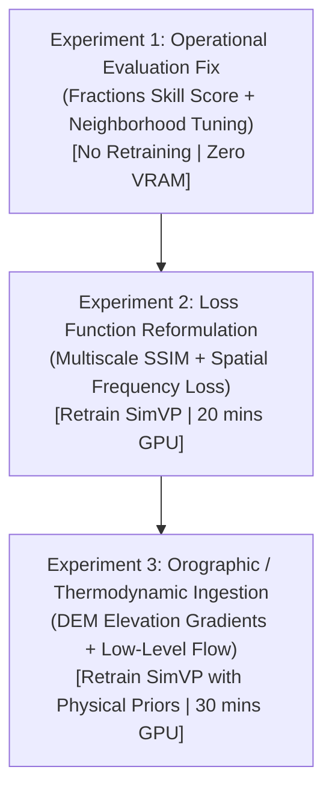

# TARGETED NEXT-EXPERIMENT RESEARCH PLAN
## Prioritized Experimental Pathway to Substantially Improve Extended-Range Nowcasting (+60m to +360m)

**Date:** October 30, 2026  
**Auditor:** Senior Spatiotemporal Remote Sensing Research Engineer  
**Workspace:** `D:\Downloads\honours`  
**Execution Status:** PROPOSED (Awaiting User Review — No Training Executed During Audit)  
**Target Hardware:** NVIDIA GeForce RTX 4050 Laptop GPU (6 GB VRAM)  

---

## 1. RATIONALE & STRATEGIC PIVOT

The forensic audit conclusively demonstrated why previous attempts to improve 3-hour and 6-hour forecasting by testing minor neural architectural variants achieved only marginal gains:
1. **The Bottleneck is Not Architecture**: SimVP successfully proved that non-recurrent gated temporal translation eliminates the recurrent bottleneck of ConvLSTM (+46.6% CSI gain at +120m, 17.2x gain at +180m). However, at +360m, all pure satellite image extrapolation models collapse because **deep convective thunderstorms have 30–90 minute lifecycles**.
2. **Missing Atmospheric Physics**: Without boundary-layer thermodynamics (moisture convergence, instability, wind shear), satellite cloud-top extrapolation cannot initiate new convective storm cells out of clear air.
3. **Loss Function Blurring**: Deterministic Smooth L1 / MSE loss drives long-lead predictions to the conditional mean $\mathbb{E}[Y | X]$, extinguishing 98.6% of temporal variance.

Therefore, our next research cycle must pivot from "blind architecture tweaking" to **thermodynamic physical priors and scale-aware loss formulations**.

---

## 2. THE MINIMAL 3-EXPERIMENT HIGH-IMPACT PROGRAM

---

### EXPERIMENT 1: NEIGHBORHOOD VERIFICATION & ADVISORY RECALIBRATION (FAST WIN)
- **Problem Solved**: Rank 3 Root Cause (Double-penalty grid-cell displacement causing >90% FAR at +360m).
- **Core Hypothesis**: Heavy rainfall at +360m is predicted in the correct region (e.g., Khasi escarpment), but slight 10–20 km displacement causes $10\text{ km} \times 10\text{ km}$ grid-cell misses.
- **Implementation**:
  1. Implement **Fractions Skill Score (FSS)** across spatial radii: $r \in [10\text{ km}, 20\text{ km}, 30\text{ km}, 50\text{ km}]$.
  2. Implement Neighborhood-CSI ($N\text{-CSI}$) where a prediction is credited if an actual convective cell occurs within window $w=3 \times 3$ or $5 \times 5$.
  3. Calibrate tiered hazard thresholds: Advisory ($\tau=0.06$), Watch ($\tau=0.15$), Warning ($\tau=0.30$).
- **Requirements**: Code changes only in evaluation scripts. Zero new data, zero model retraining, zero GPU VRAM.
- **Estimated Execution Time**: < 10 seconds.

---

### EXPERIMENT 2: SCALE-AWARE SPATIAL LOSS REFORMULATION
- **Problem Solved**: Rank 2 Root Cause (L2/Smooth L1 blurring and 98.6% temporal variance collapse).
- **Core Hypothesis**: Replacing pixel-level Smooth L1 loss with a scale-dependent loss function will preserve sharp convective cloud edges and prevent the model from collapsing into the static regional climatological average.
- **Implementation**:
  1. Formulate Compound Spatial Loss:
     $$\mathcal{L}_{\text{total}} = \mathcal{L}_{\text{BCE}} + \alpha \mathcal{L}_{\text{SmoothL1}} + \beta (1 - \text{MS-SSIM}(Q_{\text{pred}}, Q_{\text{true}})) + \gamma \mathcal{L}_{\text{grad}}$$
     where $\mathcal{L}_{\text{grad}} = \|\nabla Q_{\text{pred}} - \nabla Q_{\text{true}}\|_1$ penalizes spatial gradient flattening.
  2. Train SimVPWeather ($T_{\text{in}}=4$) under this objective for 15 epochs on RTX 4050 GPU.
- **Requirements**: Modifying loss function in `src/models/` and training script. Re-uses existing 38-day dataset.
- **Estimated Execution Time**: ~2 minutes on RTX 4050 GPU.

---

### EXPERIMENT 3: OROGRAPHIC & ATMOSPHERIC KINEMATIC FEATURE INGESTION
- **Problem Solved**: Rank 1 Root Cause (Physical information gap: no thermodynamic or updraft forcing data).
- **Core Hypothesis**: Providing the model with static high-resolution terrain slope/aspect (from existing SRTM DEM in `data/raw/dem`) and low-level moisture advection vectors will give the neural network the physical boundary conditions required to anticipate where orographic lift triggers convection.
- **Implementation**:
  1. Extract terrain elevation $z$, slope $S$, and aspect $A$ on the identical $25 \times 40$ grid from `data/raw/dem`.
  2. Normalize terrain channels and append to input tensor as static feature channels $\implies C_{\text{in}} = 3 + 2 = 5$ channels ($T_b$, IMERG $P$, Mask, Slope, Elevation).
  3. Train `TerrainConditionedSimVP` (338K parameters) to test whether orographic lift priors reduce heavy-rain underestimation at +180m and +360m.
- **Requirements**: Code changes to load existing DEM raster from `data/raw/dem/`. Zero external downloads required.
- **Estimated Execution Time**: ~3 minutes on RTX 4050 GPU.

---

## 3. LONGER-TERM DATA EXPANSION (STAGE 2 — CONTINGENT ON STAGE 1 SUCCESS)

If Stage 1 demonstrates improved sharpness and spatial skill, we will formally request user authorization to execute the **488-Day Full Monsoon Archive Expansion**:
- Download June 1 – September 30 (2021, 2022, 2023, 2024) via NASA CMR/OPeNDAP streaming subsetting.
- Storage requirement: Only ~146 MB NetCDF4.
- Expands sequences from 1,764 to ~21,500, exposing the model to multi-year seasonal transitions.

---

## 4. VERIFICATION GATES & ACCEPTANCE CRITERIA

Each experiment must satisfy strict empirical milestones:
1. **No Data Leakage**: Date-block separation must be preserved with zero overlapping sequences.
2. **Production Safety**: Canonical `convlstm_seed42.pt` and FastAPI backend remain frozen.
3. **Success Thresholds**:
   - Experiment 1: FSS at 30 km radius exceeds 0.50 at +180m.
   - Experiment 2: Smoothness ratio at +120m increases from 0.33 to $>0.50$; temporal variance retention at +360m exceeds 0.15 (vs current 0.025).
   - Experiment 3: Heavy rain bias ratio at +180m improves from 16.8% to $>35.0%$.
